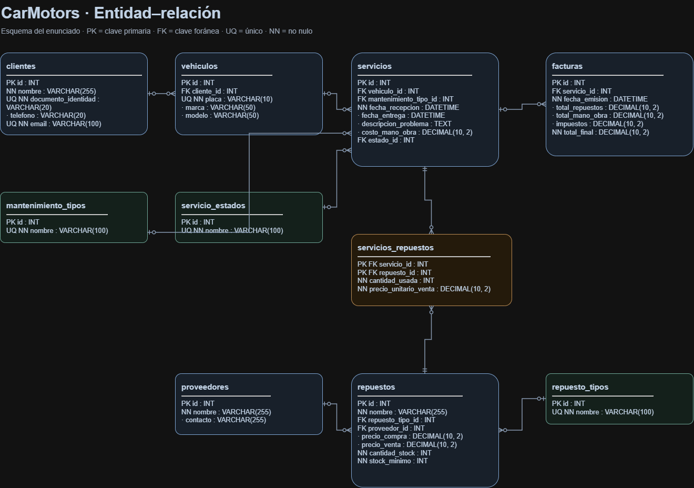

# Sistema de Gestión para el Taller Automotriz CarMotors

CarMotors es una aplicación de consola que gestiona un taller automotriz completo: clientes y vehículos,
órdenes de servicio con su ciclo de estados, inventario de repuestos y proveedores, facturación en
archivos `.txt` y reportes gerenciales.

## Tecnologías

Java 17, MySQL 8, JDBC, Maven y consola.

## Módulos

| Módulo | Menú | Qué hace |
|---|---|---|
| **Clientes y vehículos** | 1 | Registro de clientes y vehículos, historial de servicios y recordatorios de mantenimiento preventivo. |
| **Órdenes de servicio** | 2 | Crear, consultar y listar órdenes; registrar y asignar técnicos; agregar repuestos a la orden y avanzar su estado. |
| **Inventario y proveedores** | 3 | Catálogo de repuestos y proveedores, lotes con caducidad, evaluación de proveedores y alertas de stock bajo. |
| **Facturación** | 4 | Vista previa, emisión de la factura en `.txt` (con IVA del 19 %) y regeneración del archivo. |
| **Reportes gerenciales** | 5 | Servicios más solicitados (por nombre, como «Cambio de aceite»), productividad por técnico y consumo de repuestos en un periodo. |

## Ciclo de una orden

```
Pendiente ──► En Proceso ──► Completado ──► Facturado ──► Entregado
   │  agregar repuestos  │        │              │              │
   └── (se reservan) ────┘        │              │              └─ se guarda la fecha de entrega
                                  │              └─ solo desde Facturación: se guarda la factura y el .txt
                                  └─ se descuenta del stock lo reservado (una sola vez)
```

- Una orden solo avanza al estado siguiente (menú de órdenes, opción 9). No salta estados ni retrocede.
- **Reserva:** al agregar un repuesto (opción 7) se aparta la cantidad, pero el stock todavía no baja.
  Lo disponible es `stock − reservas activas`, así que dos órdenes no pueden apartar las mismas unidades.
- **Descuento:** al pasar a `Completado` se resta del stock lo reservado, se anota en `servicios_repuestos`
  y la reserva queda `DESCONTADO`. Como el ciclo no retrocede, el stock se descuenta una sola vez.
- **Facturación:** una orden `Completado` se factura en el menú 4. La factura se guarda en la tabla `facturas`
  y la orden pasa a `Facturado` en la misma transacción. Después se escribe
  `facturas/factura-NNNNNN-orden-N.txt`. Hay un ejemplo en [docs/ejemplo-factura.txt](docs/ejemplo-factura.txt).

Cada paso que modifica varias tablas se hace en una transacción: si algo falla, no queda nada a medias.

## Base de datos

| Script | Tablas |
|---|---|
| `database/schema.sql` | Catálogos, clientes, vehículos, proveedores, repuestos, servicios, servicios_repuestos, facturas, técnicos, servicios_tecnicos, lotes, evaluaciones_proveedor y reservas_repuesto |
| `database/data.sql` | Estados, tipos, datos de ejemplo y datos de prueba de reportes |



Los diagramas actualizados del proyecto integrado (entidad-relación, clases y ciclo de estados) están en
[docs/diagramas.md](docs/diagramas.md). GitHub los dibuja automáticamente.

## Instalación y ejecución

Requisitos: JDK 17 o superior, Maven y MySQL Server 8.

1. Clonar el repositorio y entrar en `proyecto-java-grupo06`:
   ```powershell
   git clone <URL-del-repositorio>
   cd proyecto-java-grupo6/proyecto-java-grupo06
   ```
2. Abrir el cliente MySQL desde el directorio del proyecto y ejecutar los scripts, en este orden, sobre una base nueva:
   ```sql
   SOURCE database/schema.sql;
   SOURCE database/data.sql;
   ```
   Estos scripts se ejecutan una vez sobre una base nueva. No sirven como migración de una base
   que ya tiene las tablas.
3. Configurar la conexión en la terminal PowerShell (o en *Run → Edit Configurations → Environment variables* de IntelliJ):
   ```powershell
   $env:CARMOTORS_DB_URL = 'jdbc:mysql://localhost:3306/carmotors'
   $env:CARMOTORS_DB_USER = 'tu_usuario'
   $env:CARMOTORS_DB_PASSWORD = 'tu_clave'
   ```
4. Compilar y ejecutar:
   ```powershell
   mvn clean compile exec:java
   ```
   Los datos de ejemplo incluyen vehículos, tipos de mantenimiento, un técnico y dos repuestos.
   Las facturas `.txt` se guardan en la carpeta `facturas/` del directorio donde se ejecuta el programa.

## Pruebas

Compila las clases de prueba con `mvn test-compile` y ejecuta sus métodos `main` desde el IDE:

| Clase | Qué prueba |
|---|---|
| `OrdenServicioPrueba` | Validaciones, creación, consulta, asignación de técnicos, rollback y consola de órdenes |
| `RegistroCorreccionPrueba` | Validación y normalización del registro de clientes y vehículos |
| `ReportesDia2Prueba`, `ReportesDia3Prueba` | Reportes con Streams, fechas y datos de factura ([resultados esperados](docs/reportes-resultados-esperados.md)) |
| `CicloFacturaPrueba` | Ciclo de estados, reservas sin sobreventa, descuento único del stock, IVA, factura `.txt` y entrega |

- **Sin argumentos:** cálculos y validaciones, sin abrir conexiones.
- **Con `--mysql`:** usa una base exclusiva de pruebas con `schema.sql` y `data.sql` (que ya trae los
  datos de reportes). Corre primero las pruebas de reportes y después `CicloFacturaPrueba`,
  porque esta crea órdenes con la fecha actual.
- Ejecuta `OrdenServicioPrueba --h2` desde la carpeta del proyecto con H2 2.3.232 en el classpath. Comprueba la creación de órdenes, asignaciones y reintentos de consola con una base en memoria.

Las cinco pruebas pasan sin base de datos. `OrdenServicioPrueba`, `ReportesDia2Prueba`, `ReportesDia3Prueba`
y `CicloFacturaPrueba` también pasan con `--mysql` contra MySQL 8.0 (base nueva con los scripts anteriores). También se recorrió el flujo completo desde la consola:
crear la orden, reservar, completar, revisar el stock, emitir la factura y obtener el `.txt`.

## Patrones de diseño

| Patrón | Dónde | Qué resuelve |
|---|---|---|
| **MVC** | `vista/Menu*` (vista), `controlador/*Controlador` (controlador), `modelo/*` (modelo) | La consola solo lee y muestra. El controlador recibe lo que escribió el usuario y llama al servicio. El modelo representa los datos. Se puede cambiar la consola sin tocar la lógica. |
| **DAO** | `dao/*Dao` (`OrdenServicioDao`, `FacturaDao`, `RepuestoOrdenDao`, …) | Todo el SQL de cada tabla está en una sola clase. El resto del programa no escribe SQL. |
| **Singleton** | `config/ConexionFactory` | Hay una única fábrica de conexiones (`getInstancia()`) con la configuración de la base. |
| **Factory** | `ConexionFactory.abrir()` | Encapsula cómo se crea una conexión JDBC (URL, usuario y clave desde variables de entorno). Quien la pide no sabe cómo se crea. |
| **Capa de servicio** | `servicio/*Servicio` (`OrdenServicioServicio`, `FacturaServicio`, …) | Concentra las reglas del negocio y las transacciones: ciclo de estados, stock disponible, IVA. |

Otras decisiones:
- **Inyección de dependencias:** servicios, controladores y vistas reciben sus colaboradores por el constructor.
  La interfaz funcional `Conexiones` permite probar las validaciones sin una base real.
- **Transacciones:** reservar, completar (descuento de stock) y facturar bloquean las filas con `SELECT … FOR UPDATE`
  y confirman o deshacen todo junto.
- **Lambdas y Streams:** reportes gerenciales (`ReporteServicio`), búsqueda de estados del catálogo y recorrido de órdenes.
- **Responsabilidad única:** presentación, coordinación, negocio y persistencia están separadas.

## Autores

Grupo 6:
- Brenda Nicol: clientes y vehículos, integración.
- Yeimer Torres: inventario y proveedores.
- Andrés: órdenes de servicio.
- Keiler: reportes gerenciales y facturación.

## Verificación de la integración

La reserva utiliza reservas_repuesto como registro común de inventario y órdenes. Conserva el precio unitario al asignar el repuesto. Completar una orden confirma el consumo y el nuevo estado en una transacción. La emisión de factura cambia el estado a Facturado y guarda la factura en la misma transacción. El menú Facturación permite emitir y regenerar el archivo de texto.

Antes de ejecutar esta versión sobre una base existente, ejecuta database/schema.sql para incorporar la columna de precio de reserva. La carpeta database conserva solo schema.sql y data.sql.

IntegracionSistemaPrueba verifica el recorrido completo con MySQL en una base temporal, incluyendo carga repetida de los SQL, cambios de estado, reserva, precio, descuento único, factura y entrega. Requiere una cuenta de pruebas con permisos para crear y eliminar esa base temporal. Se ejecuta desde la raíz del repositorio. Las seis pruebas de validaciones y cálculos también pasaron con compatibilidad Java 17.

## Presentación de la base de datos

Ejecuta database/schema.sql y luego database/data.sql completos en MySQL. data.sql carga ejemplos para las 15 tablas y termina mostrando las tablas, clientes, vehículos, proveedores, repuestos, lotes, alertas, evaluaciones, órdenes, técnicos, reservas, consumos, facturas y reportes. Los identificadores se consultan desde esos resultados y pueden variar entre instalaciones. Para repetir la demostración usa una base exclusiva de pruebas.

## Captura de datos

Los formularios vuelven a pedir los campos vacíos. Teléfono, contacto, marca y observaciones son obligatorios. Si no hay observaciones, escribe Sin observaciones. La fecha de ingreso del lote es obligatoria. Para un lote sin caducidad escribe No aplica. Los nombres de personas y de servicios admiten letras; documentos y teléfonos admiten dígitos, conservando ceros iniciales. Placas, modelos y referencias de repuestos admiten las combinaciones de letras y números necesarias.

Validación del cierre: siete pruebas ejecutables sin base de datos, integración H2 de órdenes e integración MySQL en base temporal. Se comprobó que las 15 tablas reciben datos, que ambos SQL pueden repetirse y que el flujo conserva reservas, precio, stock, factura de texto y fecha de entrega. CamposObligatoriosPrueba cubre entradas vacías en los formularios y los menús, incluido No aplica para caducidad.


## Servicios completados y avisos al cliente

En **Reportes gerenciales**, selecciona **4. Servicios completados y exportación TXT**.
Indica el rango de fechas de recepción. El reporte incluye las órdenes Completadas,
Facturadas y Entregadas. Para guardarlo en UTF-8, escribe una ruta terminada en `.txt`.

El flujo de órdenes registra la fecha de entrega cuando la orden pasa a Entregado.
Al completar o entregar una orden, el observador muestra en consola un aviso
dirigido al correo del cliente después de confirmar la transacción.

## Reserva concurrente de repuestos (condición de carrera)

**Problema.** Dos técnicos podían reservar casi al mismo tiempo la última unidad de un repuesto.
Reservar es una secuencia de tres pasos: leer cuánto hay disponible (stock menos lo ya reservado),
verificar si alcanza y guardar la reserva. Si dos hilos ejecutan esa secuencia intercalada, ambos
leen "hay 1", ambos pasan la verificación y ambos guardan su reserva: el sistema muestra dos
reservas para una sola pieza física (*race condition*).

**Solución.** La operación de reserva, `OrdenServicioServicio.agregarRepuesto`, ahora es *thread-safe*:

- La sección crítica (lectura → verificación → escritura **y el `commit`**) se ejecuta dentro de un
  bloque `synchronized` sobre un candado del repuesto. Solo un hilo a la vez puede reservar ese
  repuesto; el siguiente espera y, cuando entra, ya ve la reserva confirmada del anterior.
- Los candados están en un `ConcurrentHashMap` **estático** (uno por repuesto), así que funcionan aunque
  cada técnico use su propia instancia del servicio (`InventarioProveedorServicio.reservar` crea una
  nueva en cada llamada). Reservas de repuestos distintos no se bloquean entre sí.
- Se sigue bloqueando la fila en MySQL (`SELECT … FOR UPDATE` en `RepuestoOrdenDao.bloquear`): el
  candado de Java protege entre hilos del mismo programa y el de la base protege si hay varios
  programas conectados a la misma base.
- Cuando no alcanza, el servicio lanza `StockInsuficienteException` (subclase de
  `IllegalArgumentException`, así los menús existentes siguen funcionando igual).
- La aplicación (menú Órdenes) y la simulación usan la misma operación de reserva y el mismo DAO
  (`RepuestoOrdenDao`). Reservar no descuenta `cantidad_stock`: lo que baja es la **disponibilidad**;
  el stock físico se descuenta al completar la orden, como antes.

**Simulación.** `com.carmotors.simulacion.MainReservaConcurrente` (fuera del menú del taller) registra
el repuesto *Filtro de Aceite XY-123* con exactamente 1 unidad en stock, crea una orden por técnico y
lanza dos hilos (`Hilo-Técnico-A` y `Hilo-Técnico-B`) que esperan la misma señal (`CountDownLatch`) para
arrancar a la vez. Los dos usan la misma operación de reserva que la aplicación. Necesita una base con
`schema.sql` y `data.sql` cargados y las variables `CARMOTORS_DB_*`. Desde la carpeta `proyecto-java-grupo06`:

```powershell
mvn compile exec:java "-Dexec.mainClass=com.carmotors.simulacion.MainReservaConcurrente"
```

También se puede ejecutar su `main` desde IntelliJ. Salida esperada (el ganador puede ser A o B según
quién entre primero):

```text
Iniciando simulación de reserva concurrente para el repuesto 'Filtro de Aceite XY-123'...
Stock inicial: 1

Hilo-Técnico-A: Intentando reservar el repuesto...
Hilo-Técnico-B: Intentando reservar el repuesto...

Hilo-Técnico-A: Verificando stock. Hay 1 disponible.
Hilo-Técnico-A: ¡Reserva exitosa! Stock actualizado a 0.
Hilo-Técnico-B: Verificando stock. Hay 0 disponible.
Hilo-Técnico-B: Fallo en la reserva. No hay suficiente stock.

Simulación finalizada.
Reservó la última unidad: Hilo-Técnico-A
Reserva rechazada: Hilo-Técnico-B
Stock final del repuesto: 0
```

El stock que muestra la simulación es el **disponible** (stock menos lo reservado). Cada ejecución
registra un repuesto nuevo y dos órdenes nuevas; usa una base de pruebas para no mezclar estos datos
con los del taller.
